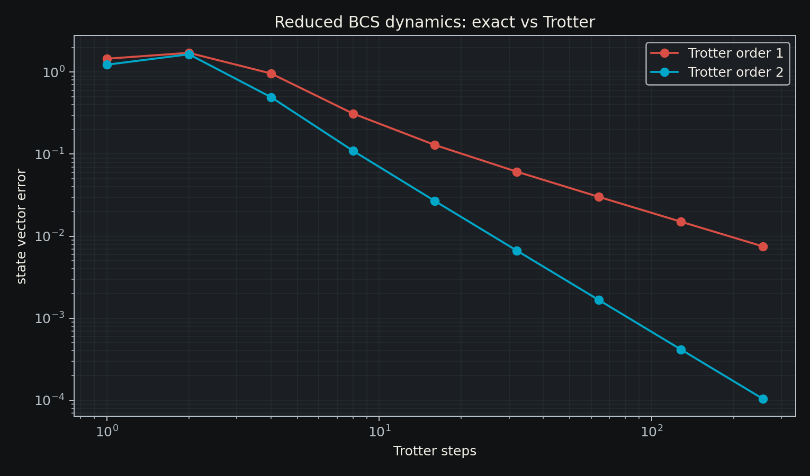
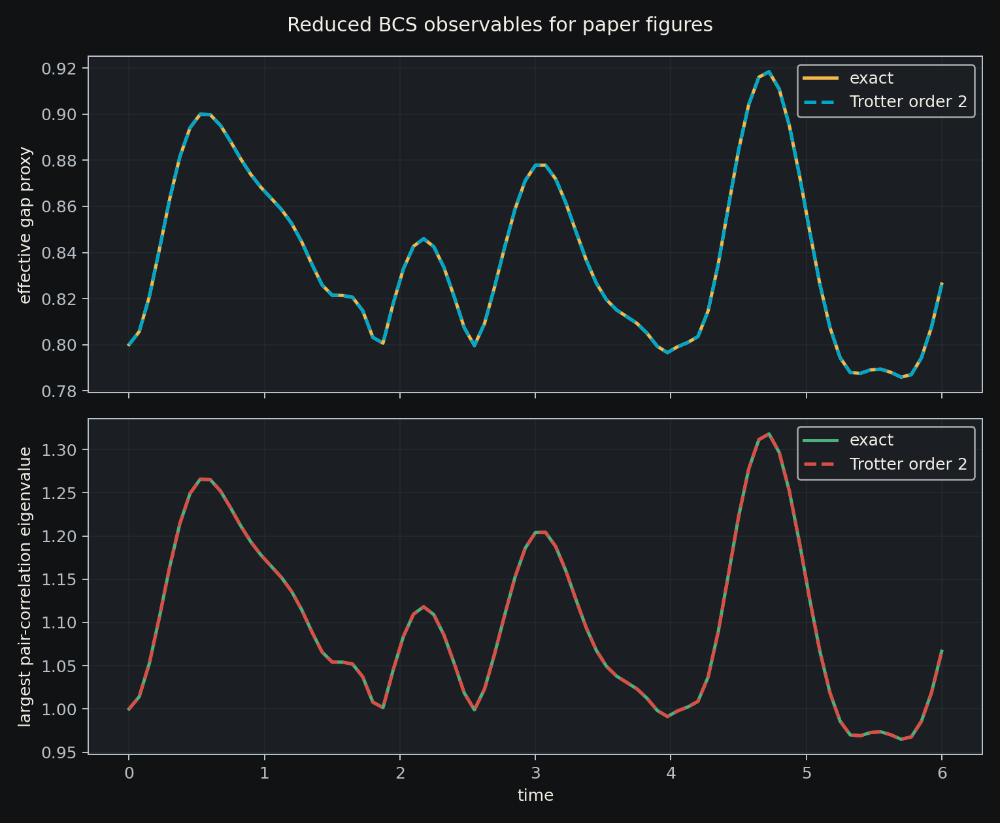
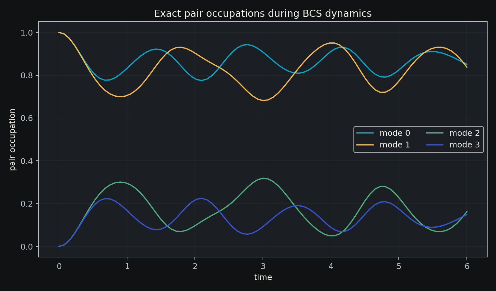
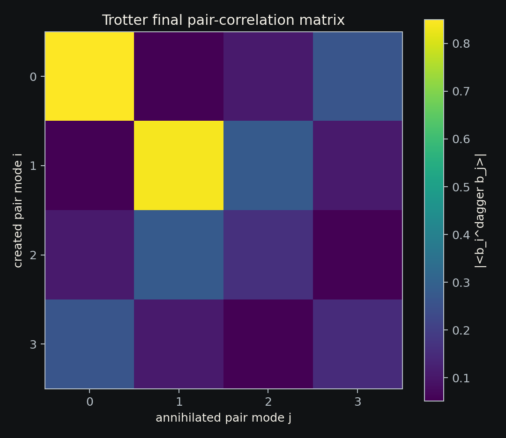
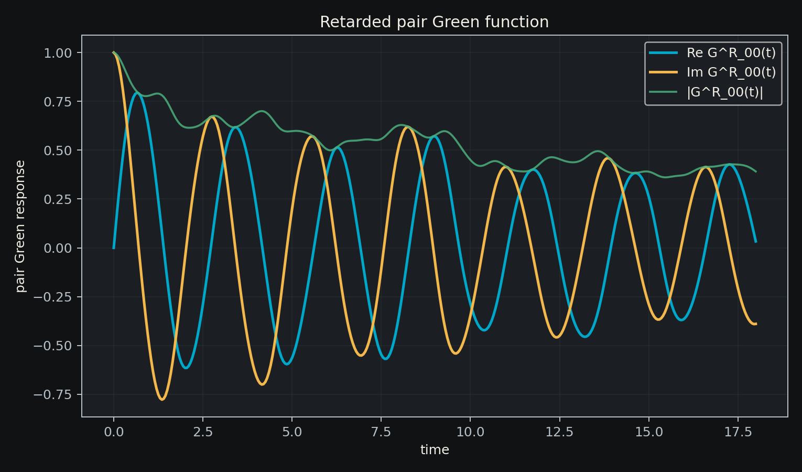
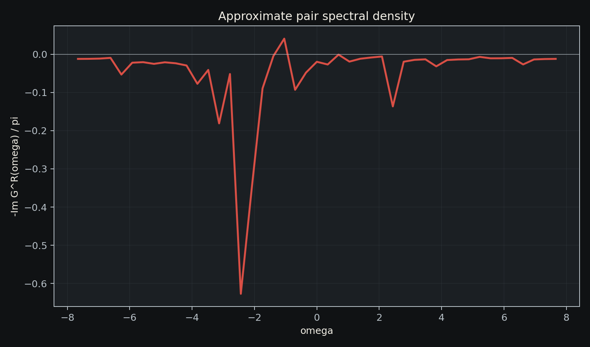

# Resumo

Este trabalho apresenta uma implementação reprodutível do Hamiltoniano BCS
reduzido em qubits, usando pseudospins de Anderson, evolução exata por
exponenciação matricial e dinâmica aproximada por Trotterização de primeira e
segunda ordem. A implementação compara a dinâmica matricial com uma realização
em circuito Qiskit, mede conservação do número de pares e extrai observáveis
físicos úteis para análise de supercondutividade em espaço de Hilbert pequeno:
ocupações de pares, matriz de correlação `C_ij=<b_i^\dagger b_j>`, autovalor
condensado, um proxy efetivo de gap e uma função de Green retardada de pares.
Para o caso de quatro qubits estudado, a
Trotterização de segunda ordem com 64 passos atinge fidelidade `0.9999989` em
`t=2.5`, e a série temporal até `t=6.0` preserva o número total de pares com erro
da ordem de `10^-13`.

# 1. Introdução

O modelo BCS descreve a formação coletiva de pares de Cooper em sistemas
fermiônicos. Na formulação reduzida, pares de estados temporais reversos são
tratados como graus de liberdade efetivos, que podem ser mapeados para
pseudospins de Anderson. Esse mapeamento torna o problema naturalmente adequado
à simulação quântica digital, pois cada modo de par pode ser representado por
um qubit.

O objetivo deste projeto é construir uma ponte prática entre a formulação
teórica do Hamiltoniano BCS reduzido e circuitos quânticos executáveis em
ferramentas modernas. O foco aqui não é escalar para sistemas grandes, mas sim
fixar uma implementação verificável, com métricas de erro e observáveis físicos
claros.

# 2. Modelo

Cada qubit representa um modo de par:

```text
|0> = modo sem par
|1> = modo ocupado por um par de Cooper
```

O Hamiltoniano BCS reduzido usado nos experimentos é

```text
H = sum_k xi_k Z_k - g/2 sum_{i<j} (X_i X_j + Y_i Y_j).
```

O primeiro termo representa energias de pseudospin associadas aos níveis
`xi_k`. O segundo termo troca pares entre modos, preservando o número total de
pares. O operador de número usado no código é

```text
N = sum_i (I - Z_i)/2.
```

Como `[H, N] = 0`, a conservação de número de pares é uma verificação direta da
consistência da implementação.

# 3. Métodos computacionais

## 3.1 Evolução exata

A evolução de referência é calculada por

```text
|psi(t)> = exp(-i H t) |psi(0)>.
```

Ela é implementada em `src/bcs.py` sobre matrizes densas. Essa escolha é
adequada para o caso de validação com quatro qubits e permite comparação direta
com aproximações Trotterizadas.

## 3.2 Trotterização

A decomposição de primeira ordem aplica sequencialmente a exponencial de cada
termo do Hamiltoniano:

```text
U_1(dt) = prod_a exp(-i H_a dt).
```

A decomposição de segunda ordem usa a forma simétrica:

```text
U_2(dt) = prod_a exp(-i H_a dt/2) prod_a^reverse exp(-i H_a dt/2).
```

O erro é medido por fidelidade e norma do vetor diferença entre estado exato e
estado Trotterizado.

## 3.3 Circuito Qiskit

A versão em circuito usa portas `RZ`, `RXX` e `RYY`, compatíveis com os termos
`Z_i`, `X_i X_j` e `Y_i Y_j`. O circuito Trotterizado é comparado contra a
evolução matricial usando a mesma ordenação lógica de qubits.

## 3.4 Observáveis físicos

Além de energia, fidelidade e número total de pares, são extraídos:

- ocupações `n_i=<b_i^\dagger b_i>`;
- matriz de correlação de pares `C_ij=<b_i^\dagger b_j>`;
- autovalor condensado `lambda_max(C)`;
- proxy de gap efetivo `Delta_eff=g sqrt(lambda_max(C))`.
- função de Green retardada de pares
  `G^R_ij(t)=-i theta(t)<[b_i(t),b_j^\dagger(0)]>`;
- densidade espectral aproximada `-Im G^R(omega)/pi`.

Esses observáveis permitem discutir coerência coletiva dos pares mesmo em um
modelo pequeno.

# 4. Parâmetros do experimento

O experimento principal usa:

- `xi = [-1.0, -0.35, 0.35, 1.0]`;
- `g = 0.8`;
- estado inicial `|1100>`;
- quatro qubits;
- tempo final `t = 6.0`;
- Trotterização de segunda ordem com `64` passos para as séries temporais.

Os comandos de reprodução estão documentados em
`docs/bcs_paper_reproducibility.md`.

# 5. Resultados

## 5.1 Erro de Trotterização

A Figura 1 mostra a queda do erro de estado conforme aumenta o número de passos
de Trotter. Para `t=2.5`, a melhor linha da tabela usa ordem 2 e 64 passos, com
fidelidade `0.9999988959` e erro de estado `0.0016610647`.



## 5.2 Validação do circuito Qiskit

O circuito Qiskit de segunda ordem com oito passos para quatro qubits produziu
profundidade `177`, tamanho `258`, fidelidade contra a evolução matricial
`0.9999999999999658` e erro de estado `1.3167e-15`. Isso valida a convenção de
qubits e a decomposição em portas para o caso estudado.

## 5.3 Gap efetivo e ordem condensada

A Figura 2 mostra a evolução temporal do proxy de gap efetivo e do maior
autovalor da matriz de correlação de pares. No tempo final `t=6.0`, o gap exato
é `0.8262711774`, enquanto o valor Trotterizado é `0.8248334652`.



## 5.4 Ocupações de pares

A Figura 3 mostra a transferência de ocupação entre os modos de par. No tempo
final, as ocupações exatas são aproximadamente:

```text
n0 = 0.8513
n1 = 0.8378
n2 = 0.1622
n3 = 0.1487
```

O número total de pares permanece igual a `2.0`, como esperado pela simetria do
Hamiltoniano.



## 5.5 Matriz de correlação de pares

As Figuras 4 e 5 mostram os mapas finais de `|C_ij|` para evolução exata e
Trotterizada. A semelhança visual entre os mapas reforça que a dinâmica
Trotterizada preserva não apenas fidelidade global, mas também a estrutura de
correlação de pares.




## 5.6 Função de Green retardada

A próxima camada de resposta dinâmica é a função de Green retardada de pares:

```text
G^R_ij(t) = -i theta(t) <[b_i(t), b_j^\dagger(0)]>.
```

No experimento atual, foi calculado o canal local `G^R_00(t)` com amortecimento
suave `eta=0.04` para estabilizar a transformada discreta. A Figura 6 mostra as
partes real e imaginária da resposta no tempo.



A Figura 7 mostra a densidade espectral aproximada obtida por FFT. O maior pico
positivo da janela calculada aparece em `omega=-1.0443`, com peso espectral
aproximado `0.04078`. Essa etapa conecta a simulação digital a observáveis de
resposta linear e abre caminho para versões anômalas e equações de Gor'kov.



# 6. Discussão

Os resultados mostram três pontos principais. Primeiro, a conservação do número
de pares é preservada numericamente, com diferença final entre evolução exata e
Trotterizada da ordem de `2.1e-13`. Segundo, a Trotterização de segunda ordem
reduz rapidamente o erro para o regime de parâmetros estudado. Terceiro, a
implementação em circuito Qiskit reproduz a dinâmica matricial dentro da
precisão numérica.

O sistema de quatro qubits ainda é pequeno, mas serve como unidade de validação
para experimentos maiores. O mesmo pipeline pode ser usado para varrer `g`,
alterar a distribuição de `xi_k`, aumentar o número de modos e estudar a
robustez dos observáveis contra ruído ou medições finitas.

# 7. Conclusão

Foi construída uma implementação integrada do Hamiltoniano BCS reduzido em
qubits, incluindo dinâmica exata, Trotterização, circuito Qiskit e observáveis
físicos de pares. O código produz tabelas e figuras reprodutíveis para análise
de erro, estrutura condensada e resposta retardada. A etapa seguinte natural é
adicionar funções de Green anômalas, equações de Gor'kov e simulação com ruído
ou amostragem por shots.

# 8. Arquivos principais

- `src/bcs.py`;
- `src/bcs_qiskit.py`;
- `experiments/08_bcs_dynamics_trotter.py`;
- `experiments/09_bcs_qiskit_trotter_circuit.py`;
- `experiments/10_bcs_paper_observables.py`;
- `experiments/11_bcs_pair_green_function.py`;
- `docs/bcs_paper_reproducibility.md`;
- `results/tables/bcs_paper_observables.csv`.
- `results/tables/bcs_pair_green_retarded.csv`.
- `results/tables/bcs_pair_green_spectral_density.csv`.

# Referências iniciais

- Bardeen, Cooper e Schrieffer, teoria microscópica da supercondutividade.
- Anderson, formulação de pseudospins para o modelo BCS.
- Trotter e Suzuki, decomposições de produtos para evolução quântica.
- Nielsen e Chuang, computação quântica e informação quântica.
